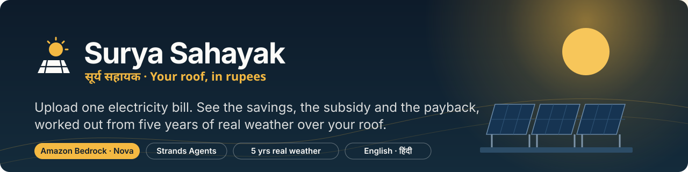
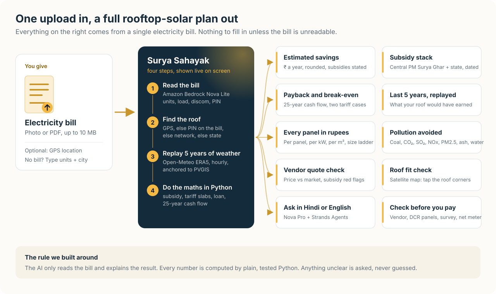
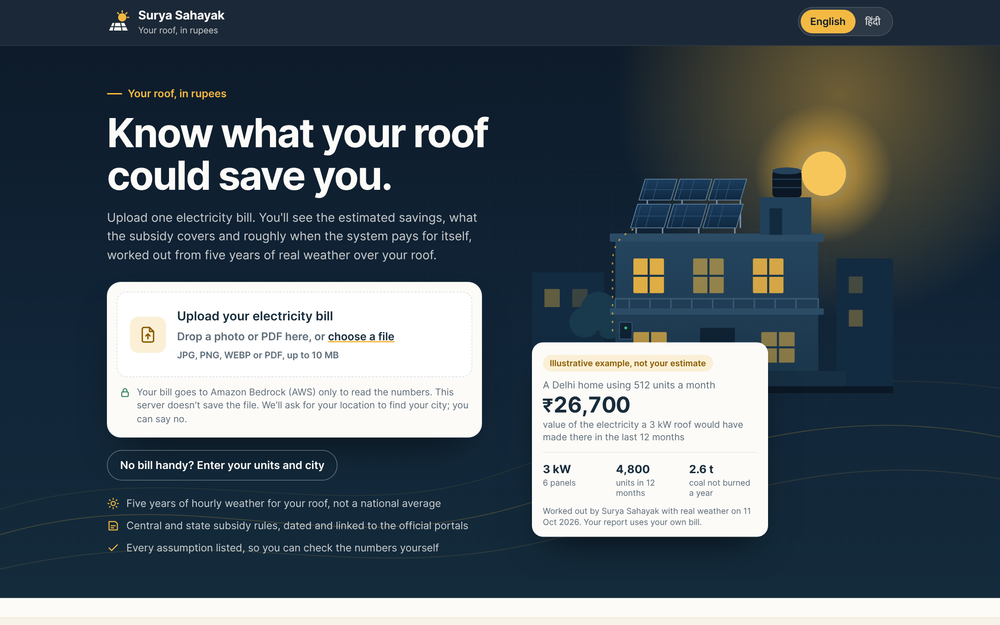
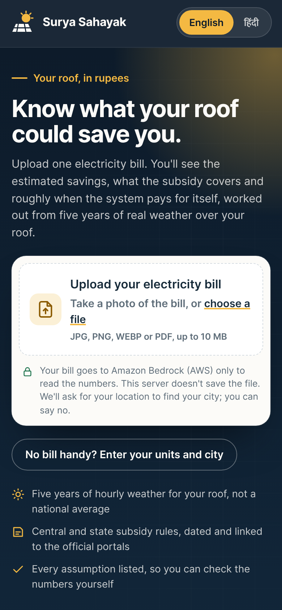
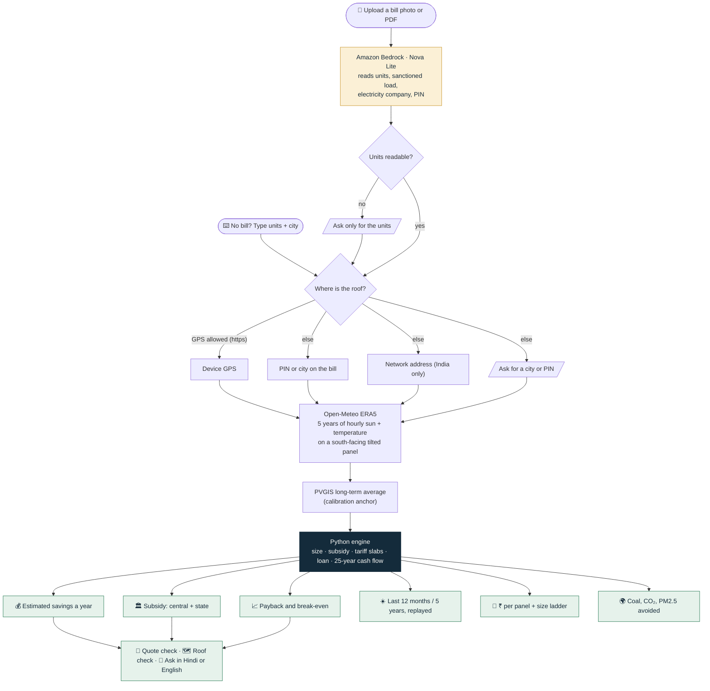
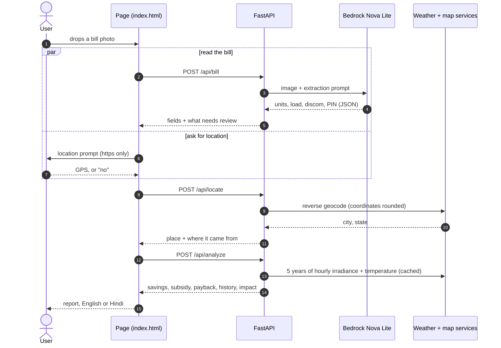
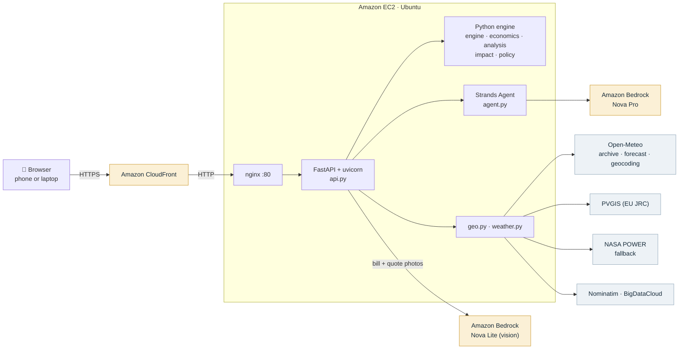

<p align="center">
  
</p>

<p align="center">
  <a href="https://d1i2jn7w01qkuh.cloudfront.net/"><b>Live demo</b></a> ·
  <a href="#how-it-works">How it works</a> ·
  <a href="#architecture">Architecture</a> ·
  <a href="#run-it-yourself">Run it</a> ·
  <a href="docs/DEPLOY.md">Deploy on AWS</a>
  https://drive.google.com/file/d/1VtHqSm0Mt256ZdwBMFdORuuSrs5NmMhX/view
</p>
https://youtu.be/rZ3P_bCCZeM
<p align="center">
  
  
  
  
  
  
  
</p>

**Surya Sahayak** (सूर्य सहायक, "the sun's helper") turns one photo of an Indian electricity bill into a complete
rooftop-solar plan: estimated savings in rupees, the subsidy you're entitled to, roughly when the system pays for
itself, what your roof *would have* earned over the last five years of real weather, and the coal and pollution it
keeps out of the air. It also checks a vendor's quotation before you sign, and answers questions in Hindi or English.

Built for the AWS hackathon, **Track 03: Waste & Energy**.

---

## Contents

- [The problem](#the-problem)
- [What it does](#what-it-does)
- [How it works](#how-it-works)
- [Architecture](#architecture)
- [The rule we built around](#the-rule-we-built-around)
- [What is measured, what is estimated](#what-is-measured-what-is-estimated)
- [Privacy](#privacy)
- [Run it yourself](#run-it-yourself)
- [API](#api)
- [Project structure](#project-structure)
- [Testing](#testing)
- [Limitations and next steps](#limitations-and-next-steps)
- [Credits and license](#credits-and-license)

---

## The problem

India's **PM Surya Ghar: Muft Bijli Yojana** pays up to **₹78,000** towards a home rooftop system, and states such as
Delhi add more. Yet most households never get past the first question, because nobody answers it for *their* home:

- **"How much would I actually save?"** Generic calculators use national averages, not your roof, your tariff or your bill.
- **"How much subsidy do I get, and when?"** The rules differ by size, by state, and change during the year.
- **"Is this vendor's quote fair?"** Quotes vary widely, and a missing detail (non-DCR panels, an unregistered vendor)
  can quietly cost the whole central subsidy.

## What it does

<p align="center">
  
</p>

<table>
  <tr>
    <td width="66%"></td>
    <td width="34%"></td>
  </tr>
  <tr>
    <td colspan="2" align="center"><sub>The first screen on a laptop and a phone. The example card is a labelled illustration from a real run (Delhi, 512 units a month, 11 Oct 2026); your report uses your own bill. <a href="docs/screenshots/hero-desktop-hindi.png">Same page in Hindi</a>.</sub></td>
  </tr>
</table>

<!--
  Add screenshots of a real report from the live site here, e.g.
  
  
  
-->


| Feature | What the user sees | How it's worked out |
|---|---|---|
| **One-upload start** | Drop a bill photo or PDF (or type units + city). The page shows upload progress, then "Bill read: 512 units a month". | Amazon Bedrock **Nova Lite** reads the bill into JSON. Anything unreadable is asked for, never guessed. |
| **Automatic location** | "Hauz Khas, New Delhi · from your device's GPS" | GPS (on https) → PIN or city on the bill → network address (India only) → state capital. If GPS and the bill disagree, the bill wins, with a one-tap switch. |
| **Estimated savings dashboard** | Savings a year (rounded to ₹100), system size, installation cost, subsidy, what you pay, approximate payback, units a year | Python engine: consumption, roof and load limits, "does the extra kW pay back in 10 years?", DERC slabs for Delhi, loan EMI. |
| **Last 12 months / 5 years, replayed** | What the same system would have generated on your roof, month by month, in units and ₹ | Open-Meteo **ERA5** hourly irradiance on a south-facing panel at the best tilt for your latitude, temperature-corrected, anchored to **PVGIS**. |
| **Every panel in rupees** | ₹ per panel per year / month / day, ₹ per m², and a size ladder showing what each extra kW buys | Per-panel split of the same cash flow; marginal cost, subsidy and saving for each size step. |
| **Payback and break-even chart** | "Free after 1–2 years", with a 25-year chart in two cases | Cash flow with 0.5 %/yr panel ageing, an inverter replacement in year 12 and upkeep after year 5; tariff flat vs +3 %/yr. |
| **Pollution avoided** | Coal, petrol-equivalent CO₂, CO₂, SO₂, NOx, PM2.5, fly ash, water, trees; for 12 months, 5 years or 25 years | CEA grid emission factor minus panel manufacturing; coal-plant factors from published studies (±20–30 %). |
| **Subsidy stack** | Central PM Surya Ghar + state, a "pay today / refunded later" timeline, conditions, documents | `policy.py`: every rule carries an `as_of` date and a link to the official portal. State top-ups that aren't confirmed are shown but **not counted**. |
| **Check before you pay** | Four things to confirm: subsidy on the portal, a registered vendor with DCR panels, a site survey, the net meter | Static guidance tied to the subsidy conditions. |
| **Roof fit check** | Tap the roof corners on a satellite map; the plan resizes to what fits | Geodesic polygon area; reminder that shade, direction and strength still need a site survey. |
| **Vendor quote check** | "Priced above the typical range", possible overpayment, items that could cost the subsidy, questions to ask | Price per kW vs a market band per size; required items (DCR, registration, net meter, earthing, warranty). Photo quotes are read by Nova Lite. |
| **Ask in Hindi or English** | Suggested questions; answers formatted in short paragraphs and lists | **Nova Pro** through **Strands Agents**, with the report as context and tools for "what if I install 5 kW?". |
| **Full Hindi** | One tap switches every label, finding, assumption and condition | Hand-written Hindi copy; backend findings carry codes or Hindi twins. |

## How it works



What happens when someone drops a bill on the page:



## Architecture



| AWS service | Used for |
|---|---|
| **Amazon Bedrock · Nova Lite** (`apac.amazon.nova-lite-v1:0`) | Reading bill and quotation photos/PDFs into structured JSON |
| **Amazon Bedrock · Nova Pro** (`apac.amazon.nova-pro-v1:0`) | The question-answering agent |
| **Strands Agents SDK** | Agent loop with tools: `make_solar_plan`, `what_if_system_size`, `audit_vendor_quote`, `application_checklist` |
| **Amazon EC2** (Ubuntu, systemd + nginx) | Runs the FastAPI app; an IAM role gives it Bedrock access, so no keys live on the server |
| **Amazon CloudFront** | Free `https://…cloudfront.net` front door. Browsers only allow GPS on https pages |
| **Amazon S3** (optional) | Keeps uploads only if `S3_BUCKET` is set; the page's privacy note reads this setting and says so |

The whole frontend is one dependency-free file (`web/index.html`): no build step, Leaflet loaded only for the roof map.

## The rule we built around

> **The AI reads and explains. Plain, tested Python does every calculation. Anything unclear is asked, never guessed.**

- The language model never produces a rupee figure. It extracts fields from the bill, and it explains the report.
- Every policy number lives in one file (`surya/policy.py`) with an `as_of` date and an official source link.
- When a service is down, the page says so: weather unavailable → a typical year with a visible warning, never invented history.
  Test fakes exist only under `tests/`.

## What is measured, what is estimated

| Number | Source | How sure |
|---|---|---|
| Past 12 months / 5 years of sunshine | Open-Meteo Historical (ERA5), hourly, on the tilted panel | Real record, anchored to PVGIS's long-term average (shown on the page) |
| Yearly generation | PVGIS typical year, temperature and 14 % system losses | Standard engineering estimate |
| ₹ value | Today's tariff (DERC slabs for Delhi; elsewhere the bill's own rate, or ₹7/unit if unreadable, with a warning) and your monthly use | "Same system at today's prices", not what you'd have saved back then |
| Subsidy | `policy.py`, dated | Verify on [pmsuryaghar.gov.in](https://pmsuryaghar.gov.in) and [solar.delhi.gov.in](https://solar.delhi.gov.in) |
| Payback | 25-year cash flow, two tariff cases | Shown as a range, labelled "approximate" |
| Coal, CO₂, SO₂, NOx, PM2.5, ash, water | CEA grid factor 0.727 kg CO₂/kWh minus 0.041 for panel manufacture; coal-plant factors | ±20–30 %. Petrol is a CO₂ *equivalent* |

**Policy state (as of 10 Oct 2026):** central ₹30,000/kW for the first 2 kW and ₹18,000 for the third (cap ₹78,000);
DCR panels and a registered vendor required. Delhi's cabinet approved a second amendment to its Solar Energy Policy on
2 Sep 2026: ₹78,000 on top of the central subsidy, and up to 3 kW at ₹0 upfront for homes averaging ≤400 units a month.
Whether Delhi's ₹78,000 applies above 400 units was not yet confirmed; the page shows this caveat.

## Privacy

- The bill goes to **Amazon Bedrock only to read the numbers**. The server reads uploads in memory and does not save them,
  unless the operator sets `S3_BUCKET`, in which case the page's privacy note says so.
- The browser drops the consumer name and account number right after the bill is read; they are never used in calculations.
- Weather and map services only receive an approximate location (coordinates rounded to about 1 km for weather), or a PIN code or city.
- The network address is used once, only when there's no GPS and no address on the bill.

## Run it yourself

```bash
git clone https://github.com/<you>/surya-sahayak.git && cd surya-sahayak
python -m venv .venv && source .venv/bin/activate
pip install -r requirements.txt
cp .env.example .env            # region + model IDs; AWS credentials come from your profile or an IAM role

python -m pytest -q tests                      # 69 tests, no AWS or internet needed
python check_bedrock.py                        # which Nova model IDs work in your region
python check_live.py                           # probes every outside service, then builds one real report
uvicorn api:app --host 127.0.0.1 --port 8000   # open http://127.0.0.1:8000 (localhost counts as secure, so GPS works)
```

Requirements: Python 3.11+, an AWS account with Bedrock model access to **Nova Lite** and **Nova Pro** in your region.

**Deploying on AWS** (EC2 + nginx + systemd + CloudFront for https) is written up step by step in **[docs/DEPLOY.md](docs/DEPLOY.md)**.

## API

| Method | Path | What it does | AI? |
|---|---|---|---|
| `POST` | `/api/bill` | Bill photo/PDF → fields (`needs_review` lists what to confirm) | Nova Lite |
| `POST` | `/api/locate` | GPS / bill / typed place / network address → city, state, PIN, coordinates | – |
| `POST` | `/api/analyze` | Location + units → full report (history, per-panel, break-even, subsidy, impact) | – |
| `POST` | `/api/auto` | One bill photo (+ optional `lat`, `lon`) → bill, location and report in one call | Nova Lite |
| `POST` | `/api/quote` | Quotation photo/PDF/text → price check and red flags | Nova Lite for photos |
| `POST` | `/api/chat` | Questions about the report, English or Hindi | Nova Pro (Strands) |
| `POST` | `/api/plan` | Single-year plan calculator (older endpoint) | – |
| `GET` | `/api/health` · `/api/policy` · `/api/checklist` | Health and storage flag · rules in force · documents list | – |
| `GET` | `/api/docs` | Interactive OpenAPI docs | – |

## Project structure

```
surya-sahayak/
├── api.py                 FastAPI app: routes, upload checks, optional S3
├── surya/
│   ├── bill.py            bill photo → fields (Bedrock Nova Lite via llm.py)
│   ├── llm.py             Bedrock Converse calls, image shrinking, JSON parsing
│   ├── geo.py             GPS / PIN / city / network → place (Nominatim, BigDataCloud, Open-Meteo geocoding)
│   ├── weather.py         5-year hourly history (Open-Meteo ERA5, NASA POWER fallback), live "right now"
│   ├── engine.py          sizing, Delhi slab bills, subsidy, loan, PVGIS yield
│   ├── economics.py       per-panel rupees, size ladder, 25-year break-even
│   ├── analysis.py        puts it all together into one report
│   ├── impact.py          coal, CO₂, SO₂, NOx, PM2.5, ash, water, petrol-equivalent
│   ├── policy.py          every subsidy / tariff / benchmark number, with as_of dates
│   ├── quote.py           vendor quotation audit
│   ├── agent.py           Strands agent (Nova Pro) and its tools
│   ├── states.py          state codes, capitals, discom → state
│   └── schemas.py         request / response models
├── web/index.html         the whole frontend: one file, English + Hindi
├── tests/                 69 unit tests + a Playwright browser suite (outside services faked)
├── deploy/                systemd unit, nginx site, CloudFront https script
├── check_bedrock.py       which model IDs work in your region
├── check_live.py          live probe of every outside service + one real report
└── docs/                  deploy guide, diagrams, screenshots
```

## Testing

| Suite | What it covers | Command |
|---|---|---|
| Unit (69) | Engine maths, subsidy slabs, Delhi tariff, weather parsing, location fallbacks, quote rules, Hindi parity, API | `python -m pytest -q tests` |
| Browser (117 checks) | Real app in Chromium, desktop and 390 px phone, English and Hindi: GPS allowed / blocked / other state, weather down, PVGIS down, unreadable bill, missing units or city, wrong file type, 11 MB file, manual entry with validation, quote grouping, roof undo, chat context, start over | `LEAFLET_DIR=… python tests/e2e_ui.py out/` |
| Accessibility | axe-core WCAG 2 A/AA on landing, report (EN + HI), quote, roof, chat, form errors, upload errors: 0 violations | run with the browser suite |
| Live | Every outside service from your own server, then one real report | `python check_live.py` |

The unit suite also runs on every push through GitHub Actions (`.github/workflows/tests.yml`).

## Limitations and next steps

- Subsidy and tariff rules are hand-maintained in `policy.py`; a scheduled check against the official portals is the next step.
- The ₹3.5/unit net-metering export rate, Delhi's per-kW scaling below 3 kW, and installed-price bands are assumptions, listed on the page.
- Generation assumes a south-facing panel at the best fixed tilt; real roofs with shade or other orientations produce less.
- The Open-Meteo free tier is for non-commercial use; a commercial launch would need their paid plan. Results are cached per ~1 km cell.
- Next: more state top-ups once confirmed, bill history from multiple photos, vendor lists from the national portal.


## Team

 Name                  email
Aaditya Sharma   aaditya.sharma.ug23@nsut.ac.in
Pawan Poudel     pawan.poudel.ug24@nsut.ac.in
Subham Yadav     subham.yadav.ug24@nust.ac.in

## Credits and license

Weather: [Open-Meteo.com](https://open-meteo.com/) (CC BY 4.0), ERA5 © ECMWF / Copernicus ·
Solar yield: [PVGIS](https://re.jrc.ec.europa.eu/pvg_tools/en/) © European Union, JRC ·
Fallback weather: [NASA POWER](https://power.larc.nasa.gov/) ·
Maps and places: © [OpenStreetMap](https://www.openstreetmap.org/copyright) contributors (ODbL), Esri World Imagery, BigDataCloud, ipwho.is / ip-api.com.

Surya Sahayak gives estimates, not a sanction or a guaranteed return. Code under the [MIT License](LICENSE).
