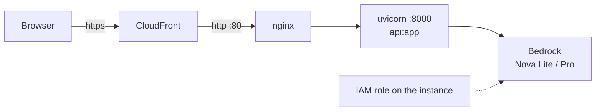

# Deploying Surya Sahayak on AWS

This is the setup the live demo runs on: one small EC2 instance (Ubuntu) running FastAPI behind nginx, an IAM role
for Bedrock (no access keys on the server), and a CloudFront distribution in front for https, which browsers require
before they offer GPS.



Time needed: about 30 minutes, most of it waiting for CloudFront.

---

## 1. Bedrock model access

1. Pick a region that offers Amazon Nova, for example **ap-southeast-2 (Sydney)** or **ap-south-1 (Mumbai)**.
2. In the Bedrock console, if your account still shows a **Model access** page, enable **Amazon Nova Lite** and **Amazon Nova Pro**.
3. Note the model IDs. In APAC regions the cross-region inference profiles are `apac.amazon.nova-lite-v1:0` and
   `apac.amazon.nova-pro-v1:0`. `python check_bedrock.py` (step 4) tells you which IDs work in your region.

## 2. IAM role for the instance

Create a role for **EC2** with this inline policy, and name it, for example, `surya-ec2-role`:

```json
{
  "Version": "2012-10-17",
  "Statement": [
    { "Effect": "Allow",
      "Action": ["bedrock:InvokeModel", "bedrock:InvokeModelWithResponseStream"],
      "Resource": "*" }
  ]
}
```

Only if you want to keep uploads, add `s3:PutObject` on your bucket and set `S3_BUCKET` in `.env` (step 4).
The page's privacy note reads this setting from `/api/health` and tells users whether files are kept.

## 3. Launch the instance

- **AMI:** Ubuntu Server 24.04 LTS · **Type:** t3.small (t3.micro works for a demo)
- **IAM instance profile:** the role from step 2
- **Security group inbound:** SSH 22 from your IP, HTTP 80 from anywhere (CloudFront connects on 80)

Connect with **EC2 Instance Connect** or SSH as `ubuntu`.

## 4. Install the app

```bash
sudo apt update && sudo apt install -y python3-venv python3-pip nginx git
cd ~ && git clone https://github.com/<you>/surya-sahayak.git && cd surya-sahayak
python3 -m venv .venv && source .venv/bin/activate
pip install -r requirements.txt
cp .env.example .env && nano .env      # set AWS_REGION and the two model IDs
python check_bedrock.py                # every model you use should say OK
python check_live.py                   # weather, maps and one full report; expect "14 of 14 checks OK"
```

The app must live at `/home/ubuntu/surya-sahayak` for the systemd unit below; edit `deploy/surya.service` if you use another path.

## 5. Run it as a service

```bash
sudo cp deploy/surya.service /etc/systemd/system/surya.service
sudo systemctl daemon-reload
sudo systemctl enable --now surya
curl -s http://127.0.0.1:8000/api/health        # {"ok":true,...}
```

## 6. Put nginx in front

```bash
sudo cp deploy/nginx-surya.conf /etc/nginx/sites-available/surya
sudo ln -sf /etc/nginx/sites-available/surya /etc/nginx/sites-enabled/surya
sudo rm -f /etc/nginx/sites-enabled/default
sudo nginx -t && sudo systemctl reload nginx
```

`http://<public-ip>/` now shows the page. It works on plain http, but browsers won't offer GPS there, so the page
uses the PIN code or city printed on the bill instead.

## 7. Free https with CloudFront (for GPS)

Open **AWS CloudShell** (the `>_` icon in the console) and run:

```bash
curl -sO https://raw.githubusercontent.com/<you>/surya-sahayak/main/deploy/cloudfront_https.sh
INSTANCE_ID=i-0123456789abcdef0 bash cloudfront_https.sh
```

The script finds the instance's public DNS name, creates a distribution with caching disabled and every request
forwarded to port 80, then waits until it's deployed (usually 3 to 8 minutes) and prints
`READY. Open this on your phone or laptop: https://dxxxxxxxx.cloudfront.net/`.

## 8. Updating

```bash
cd ~/surya-sahayak && git pull && source .venv/bin/activate && pip install -r requirements.txt
sudo systemctl restart surya
```

## Troubleshooting

| Symptom | Check |
|---|---|
| `502 Bad Gateway` | The app isn't running: `sudo journalctl -u surya -n 50 --no-pager` |
| Bill upload says AccessDenied | The instance has no IAM role, or the role lacks `bedrock:InvokeModel`, or model access isn't enabled in that region |
| "Model identifier is invalid" | Run `python check_bedrock.py` and copy a working ID into `.env`, then restart |
| No location prompt | You're on `http://`. Use the CloudFront `https://` address |
| A typical year instead of 5-year history | Weather service unreachable from the server: run `python check_live.py` |
| Upload over 10 MB rejected | By design (`MAX_UPLOAD` in `api.py`, `client_max_body_size 12m` in nginx) |
